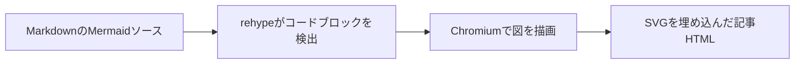

Trailでは、Markdownの `mermaid` コードブロックを図の原本にしている。AstroのビルドでSVGに変換し、記事のHTMLへ直接埋め込む。GitHubの差分で図の変更を追えて、JavaScriptを無効にしたブラウザでも図を表示できる。

## ブラウザ描画からビルド時描画へ

当初は `astro-mermaid` でブラウザが記事を開いたときに描画していた。生成したSVGをHTMLに含める方式なら、GitHubで管理する図の原本はMarkdownのまま、描画処理をビルドに移せる。そこで `rehype-mermaid` の `inline-svg` を採用した。生成先の `dist/` は `.gitignore` で除外している。

この図も、記事内の `mermaid` コードブロックから生成している。



| 描画する場所 | 必要になるもの |
| --- | --- |
| 閲覧時 | ブラウザで動くMermaidと、初回表示やページ遷移後の描画処理 |
| ビルド時 | ビルド環境のChromium。閲覧時はすでに生成されたSVGを表示 |

ビルド時の方式では、配信するHTMLに図の分だけデータが増える。少数の静的な図を記事に添える場合は、ページを開くたびに図を組み立てる処理を省ける。図ごとに `accTitle` と `accDescr` を指定すると、SVGにも図の題名と説明を残せる。

## Astroの設定

`bun add @astrojs/markdown-remark rehype-mermaid playwright` で依存関係を追加する。Astro 7のMarkdownプロセッサーに `unified()` を指定し、Shikiの対象から `mermaid` を除外する。これで `rehype-mermaid` が元のコードブロックを処理できる。図ごとの描画エラーには `errorFallback` で元のブロックを残す。Chromiumを起動できない場合は、ビルド環境のセットアップを確認する。生成HTMLに `code.language-mermaid` が残っていれば、その図がSVGに変換されていないと分かる。

以下はTrailの `astro.config.mjs` からMermaidに関係する部分を抜き出した設定。既存の設定がある場合は、`markdown` をその設定に追加する。

```js
import { defineConfig } from 'astro/config';
import { unified } from '@astrojs/markdown-remark';
import rehypeMermaid from 'rehype-mermaid';

/** @type {import('rehype-mermaid').RehypeMermaidOptions} */
const mermaidOptions = {
  strategy: 'inline-svg',
  mermaidConfig: { theme: 'dark', securityLevel: 'strict' },
  errorFallback: (element) => element
};

export default defineConfig({
  markdown: {
    syntaxHighlight: { type: 'shiki', excludeLangs: ['mermaid'] },
    processor: unified({ rehypePlugins: [[rehypeMermaid, mermaidOptions]] })
  }
});
```

## Cloudflare Pagesのビルド設定

ローカルでは `bun run playwright install --only-shell chromium` で描画用のChromiumを用意し、`bun run build` を実行する。Cloudflare Pagesではビルドコマンドを `bun run build:pages`、出力先を `dist` に設定する。Trailの `build:pages` は `playwright install --only-shell chromium && astro build` を実行する。Pagesでは `--with-deps` を付けるとOSパッケージのインストールに `sudo` が必要になり、ビルドが止まった。

## 検証結果

macOS 27.2.1、Node.js 24.14.1、Bun 1.3.13、Astro 7.2.0、`rehype-mermaid` 3.0.0、Playwright 1.65.1で検証した。ローカルのビルドと型チェックが通り、JavaScriptを無効にしたChromiumでも図が表示された。今回の改稿でも、配信対象の図16点を、JavaScriptを無効にしたChromiumの幅390 pxと1280 pxで表示できることを確認した。Cloudflare Pages上のビルドは未確認。

## 参考資料

- [AstroのUnified API](https://docs.astro.build/en/reference/markdown-processors/unified/)
- [Mermaidのアクセシビリティ設定](https://mermaid.js.org/config/accessibility.html)
- [rehype-mermaidの設定](https://github.com/remcohaszing/rehype-mermaid#readme)
- [Cloudflare Pagesのビルド設定](https://developers.cloudflare.com/pages/configuration/build-configuration/)
