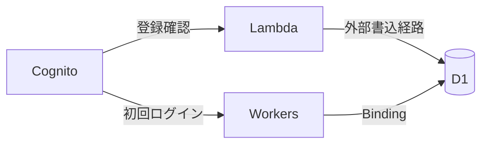

## 背景と設計

Cognito登録後にD1へユーザーを作る場所として、Post Confirmation Lambdaを検討した。登録確認時に同期できる一方、LambdaからD1へ書き込む経路、その認証、同期が失敗した後の再処理が必要になる。

代替案は初回ログイン時にWorkersがD1 Bindingで同期する方式。外部ユーザーIDの一意制約を使い、処理が再実行されても同じユーザーへ解決する。ログイン前にD1のレコードが必要な場合は、同期のタイミングが合うか確認が要る。

Lambdaの言語はJavaも検討した後にRustを希望し、npmのグローバル導入を避けるため、Rust・Zig・Cargo Lambdaをmiseで管理する方針を選んだ。以下は当時の検討コマンド。

```bash
mise install rust zig github:cargo-lambda/cargo-lambda
mise exec -- cargo lambda watch --locked --invoke-address 127.0.0.1
```

## 再実行できる書き込みにする

初回ログイン時に「SELECTして、なければINSERT」とすると、同時に来た2件がどちらも未登録と判断できる。外部IDに一意制約を置き、衝突時の処理をデータベースに任せると、同時実行でも行が増え続けない。次はSQLiteでの説明例。既存ユーザーの所属や権限を上書きする必要はない。

```sql
CREATE TABLE app_users (
    id INTEGER PRIMARY KEY,
    issuer TEXT NOT NULL,
    subject TEXT NOT NULL,
    UNIQUE (issuer, subject)
);
INSERT INTO app_users (issuer, subject) VALUES (?, ?)
ON CONFLICT (issuer, subject) DO NOTHING;
```

| 作成の契機 | 作成される時点 | 障害時に追う境界 |
| --- | --- | --- |
| Post Confirmation Lambda | Cognito側の登録確認時 | Cognitoの確認状態とD1への反映を別々に確認する |
| Workersのログイン処理 | アプリへ初めてログインしたとき | D1へ作成できるまでアプリのセッション発行を保留できる |

登録直後にアプリ側からユーザーを参照する要件があるなら、ログインまで行がない方式では満たせない。どちらでも、同期後の行を再取得するときのキーは同じ組を使う。

## 概念図



## 環境と確認状況

Cognito Post Confirmation、Workers・D1、Rust、Zig、mise、Cargo Lambda。各SDK・ツールの版は未確認。

Rust Lambdaのツール選択までは方針を確認。同期方式の最終採用、コマンドの実行、D1連携は未確認。

SQLite 3.54.1のインメモリDBでは、同一の `(issuer, subject)` を2回登録しても1行、同じ `subject` で別の `issuer` を登録すると合計2行になることを確認した。

- [Cognito Post Confirmationトリガー](https://docs.aws.amazon.com/cognito/latest/developerguide/user-pool-lambda-post-confirmation.html)
- [SQLite UPSERT](https://www.sqlite.org/lang_upsert.html)
