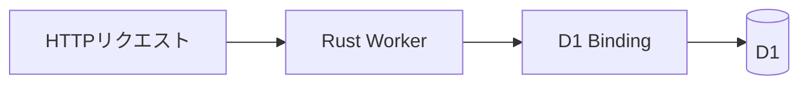

## 背景と設計

Workers上にバックエンドを作るにあたり、RustとGoを比較した。判断材料は、Wasmで動くコードからWorkersのホストAPIやD1を扱うときに、どこまで既存SDKに任せられるか。稼働していたGo実装の有無は未確認。

採用方針はRustとworker-rs。Workerの環境にD1 Bindingを設定し、リクエストを処理するRustコードから参照する。SDKを使うことで、WasmとホストAPIの橋渡しを一から用意する範囲を減らせる。

Bindingを使う方針と、SQLを置く場所は別の判断。生SQLの管理方法、Repository層の導入、Axumの利用は当時の検討事項だった。

## Bindingは実行環境が渡す接続口

Workerの設定で、コードが使う名前を対象のD1データベースに対応させる。例えば `DB` という名前に結び付ければ、Rust側は `env.d1("DB")?` でハンドルを取得する。Worker内でデータベースの接続文字列や認証トークンを組み立てる処理を持たずに済む。設定名がコードと一致することと、接続先にテーブルが作られていることはそれぞれ確認する。

SQLの値にはプレースホルダーを使う。たとえば `WHERE id = ?` として値をバインドすれば、外部から受け取ったIDはSQL構文と分けて渡せる。Bindingの名前解決と、SQLに値を束縛する処理は異なる段階にある。

## 概念図

## 環境と確認状況

Cloudflare Workers、D1、Rust、worker-rs。Rust・SDK・Wranglerの版は未確認。

RustとD1 Bindingの採用方針を確認。接続と本番稼働はこのメモでは未確認。

## 参照元

- [CloudflareのD1 Worker Binding](https://developers.cloudflare.com/d1/worker-api/)

- [Cloudflare WorkersのRust SDK](https://developers.cloudflare.com/workers/languages/rust/)
