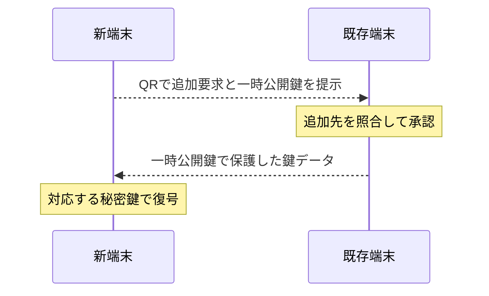

QRコードで既存端末と新しい端末を結び付けるときは、ログインの承認と、暗号化データを読める端末の追加を分けて考える。元のメモでは、PCの画面に表示したQRコードをスマートフォンで読み、必要に応じてPINで照合する流れを例にした。個別サービスのプロトコルは未確認。

以下は、新端末の画面にQRを表示し、既存端末が確認してから読取りに必要な鍵データを渡す場合の概念図。QRに載せる情報と承認後に送る情報を分けている。

## QRで渡す情報の寿命

QRを撮影できる人にも、そこに入った値が渡る。例えば端末追加用のQRを設計するなら、用途を限定した短命なセッション識別子や、新しい端末の一時公開鍵を載せる方法がある。秘密鍵は生成した端末に置き、承認済みの相手に必要な鍵データだけを暗号化して渡す。QRに含めた識別子の失効と、一度承認した要求の再利用を防ぐ処理も必要になる。

| 確認すること | 担当する処理の例 |
| --- | --- |
| アカウントへの端末追加を承認したか | 既存端末で追加先を確認して承認 |
| 承認した新端末だけが鍵データを読めるか | 新端末の公開鍵に対応する秘密鍵が必要な形で渡す |
| 追加要求を再利用できないか | 有効期限と一回限りの消費をサーバーで管理 |

PINを表示する方式でも、その値が両端末の同じやり取りに結び付いている必要がある。`authToken` はサーバーへの認証に使う資格情報で、暗号化データの復号鍵とは別に扱う。短いPINを照合する場合は、候補を繰り返し試せる回数を制限する。暗号化には認証付きの方式を使い、承認した公開鍵とセッションの対応を検証する。以下のMatrix仕様は端末検証の実例への参照であり、図は特定のプロトコルの再現ではない。各処理の関係を整理した設計例であり、鍵交換や端末追加の実装は検証していない。

- [Matrix仕様のデバイス検証](https://spec.matrix.org/latest/client-server-api/#device-verification)
