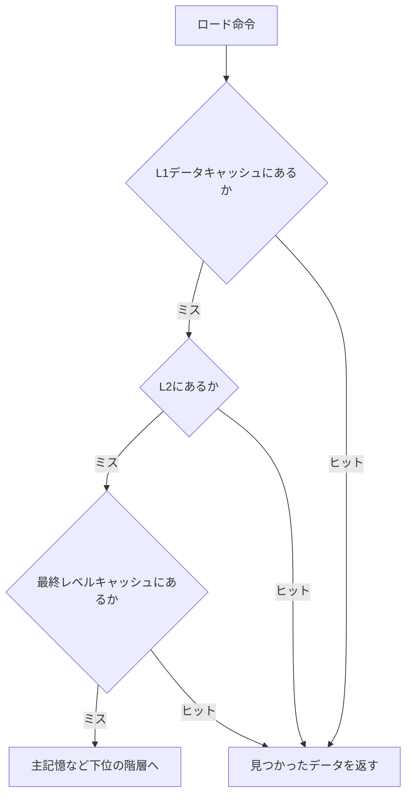

アセンブリ問題を解く中で調べたメモ。

## メモリ階層について

| 速度・価格 | 記憶装置 | アクセス時間の目安 | 容量の目安 |
| --- | --- | --- | --- |
| ▲（速・高） | レジスタ（Register） | CPUが命令から直接扱う | ISAから見えるものは数十本程度 |
| │ | L1キャッシュ（SRAM） | 約 1 ns（数サイクル） | 32〜128 KB（コアごと） |
| │ | L2キャッシュ（SRAM） | 約 3〜4 ns（数〜十数サイクル） | 512 KB〜数 MB（コアごと） |
| │ | L3キャッシュ（SRAM） | 約 10〜20 ns（数十サイクル） | 数 MB〜数百 MB（共有） |
| │ | 主記憶（メインメモリ、DRAM） | 約 50〜100 ns | 8 GB〜64 GB以上 |
| ▼（遅・安） | 二次記憶（NVMe SSD / HDD） | 10 µs〜10 ms | 256 GB〜数 TB |
| | アーカイブ記憶（テープなど） | 秒〜分 | 数 TB〜PB |

数値はCPUの世代、メモリの種類、アクセスパターンなどで変わる、ざっくりした目安だ。
3.2 GHzなら1周期は約0.31 ns。周期は周波数の逆数だ。DDR4-3200の3,200 MT/sは1データ線あたりの転送回数。クロックの立ち上がりと立ち下がりで転送するため、I/Oクロックは1,600 MHz。CPUの周波数とは別の値。
周波数が高くても、すべてのメモリアクセスや演算が同じ割合で速くなるわけではない。

アセンブリ命令は、レジスタ、メモリ、命令に埋め込まれた即値を扱う。通常のキャッシュ可能な領域では、ロード命令が指定するのはアドレス。キャッシュの確認はハードウェアが行う。

ロード命令から見た概念図。キャッシュに対象データがあればそこで取得し、なければマシンの構成に応じて下の階層を探す。



このページではx86-64のレジスタと呼び出し規約を扱う。関数の引数とスタックを観察した例は[x86-64の逆アセンブル](/posts/knowledge/asm-x86_64)と[ARM64の逆アセンブル](/posts/knowledge/asm-arm64)を参照。

## x86-64のレジスタ

x86-64の主な汎用レジスタを以下に示す。末尾の `rip` は命令ポインタ。

`rax`, `rbx`, `rcx`, `rdx`, `rsi`, `rdi`, `rbp`, `rsp`,
`r8`〜`r15`, `rip`

```text
64-bit 全体                  [ RAX ]
32-bit（下位32ビット）       [ EAX ]
16-bit（下位16ビット）       [ AX  ]
 8-bit（AXの上位8ビット）    [ AH  ]
 8-bit（AXの下位8ビット）    [ AL  ]
```

用途を分ける。`EAX`、`AX`、`AH`、`AL`は、それぞれ`RAX`の一部を指す。`EAX`などへの32ビット書き込みでは、仕様上`RAX`の上位32ビットが0になる。

### 主な役割・慣習

| レジスタ | 主な役割・慣習 |
| --- | --- |
| `rax` | 整数・ポインタの戻り値（返り値）に使う（ABIによる） |
| `rsp` | スタックポインタ。スタックの先頭を指すため、通常は自由に使わない |
| `rbp` | フレームポインタに使うことがある。省略時は汎用レジスタとして使える |
| `rip` | 次に実行する命令の位置を指す命令ポインタ |

引数の渡し先は、x86-64のチップではなくOS・ABI（呼び出し規約）で決まる。

| 規約 | 整数・ポインタ引数のレジスタ（左から第1引数） |
| --- | --- |
| System V AMD64 ABI（Linux、macOSなど） | `rdi`, `rsi`, `rdx`, `rcx`, `r8`, `r9` |
| Microsoft x64（Windows） | `rcx`, `rdx`, `r8`, `r9` |

表を超えた引数は、規約に従ってスタックなどに渡る。Windows x64では、呼び出し側が4つの引数レジスタ用のシャドウ領域も用意する。
浮動小数点引数には別の分類がある。System V AMD64では主に`xmm0`〜`xmm7`、Microsoft x64では主に`xmm0`〜`xmm3`を使う。構造体の渡し方や戻り値にも別の規則がある。

### 参考資料

- [x86-64 psABI](https://gitlab.com/x86-psABIs/x86-64-ABI)
- [Microsoft x64 calling convention](https://learn.microsoft.com/en-us/cpp/build/x64-calling-convention)
