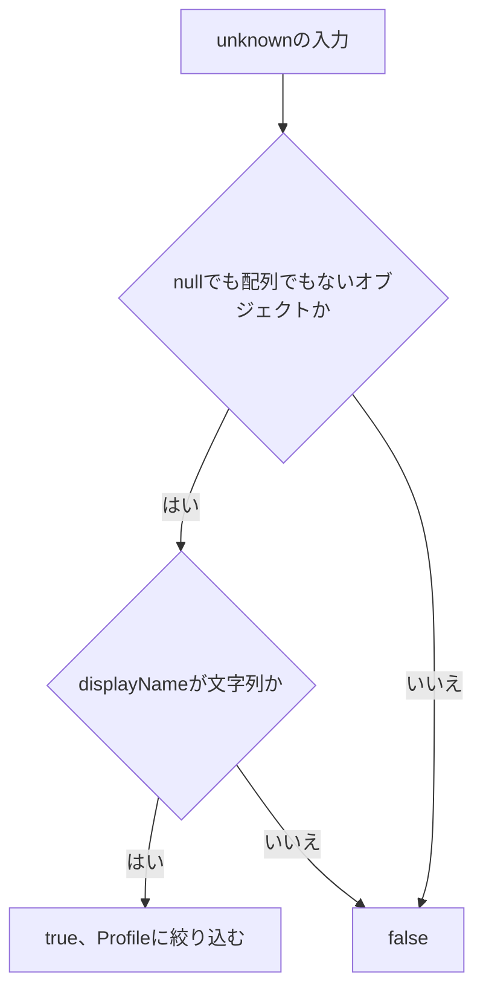

外部から受け取った `unknown` を扱うときは、実行時に確かめた条件だけをTypeScriptの型に反映する。`typeof v === "object"` でも、`null` や配列が候補に残る。さらに、それらを除いても目的のプロパティがあるとは限らない。

## 型述語が表す条件を実際に検査する

次は表示名を読むための説明例。`v is Profile` を書くと、呼び出し側の真の分岐で `v` を `Profile` として扱える。

```ts
type Profile = { displayName: string };

function isProfile(v: unknown): v is Profile {
  return typeof v === "object" && v !== null &&
    !Array.isArray(v) && "displayName" in v &&
    typeof v.displayName === "string";
}

const input: unknown = JSON.parse('{"displayName":"Aki"}');
if (isProfile(input)) console.log(input.displayName);
```

条件を上から評価し、すべてを満たした入力だけを `Profile` として扱う。



型述語の注釈だけで検査が追加されることはない。例えば名前の確認を外して `{}` を通すと、型検査に通る呼び出し側でも `displayName` は `undefined` になる。例では `JSON.parse` が成功する文字列を使っている。外部の文字列を処理する場合は、パース時の例外と、パース後の構造の不一致を別々に扱う。JSON以外のオブジェクトを同じ関数に渡す場合、`in` は継承したプロパティも含む。扱う入力に合わせて、自身のプロパティであることや文字列の長さなどを別途検査する。

- [TypeScript Handbookの型述語](https://www.typescriptlang.org/docs/handbook/2/narrowing.html#using-type-predicates)
