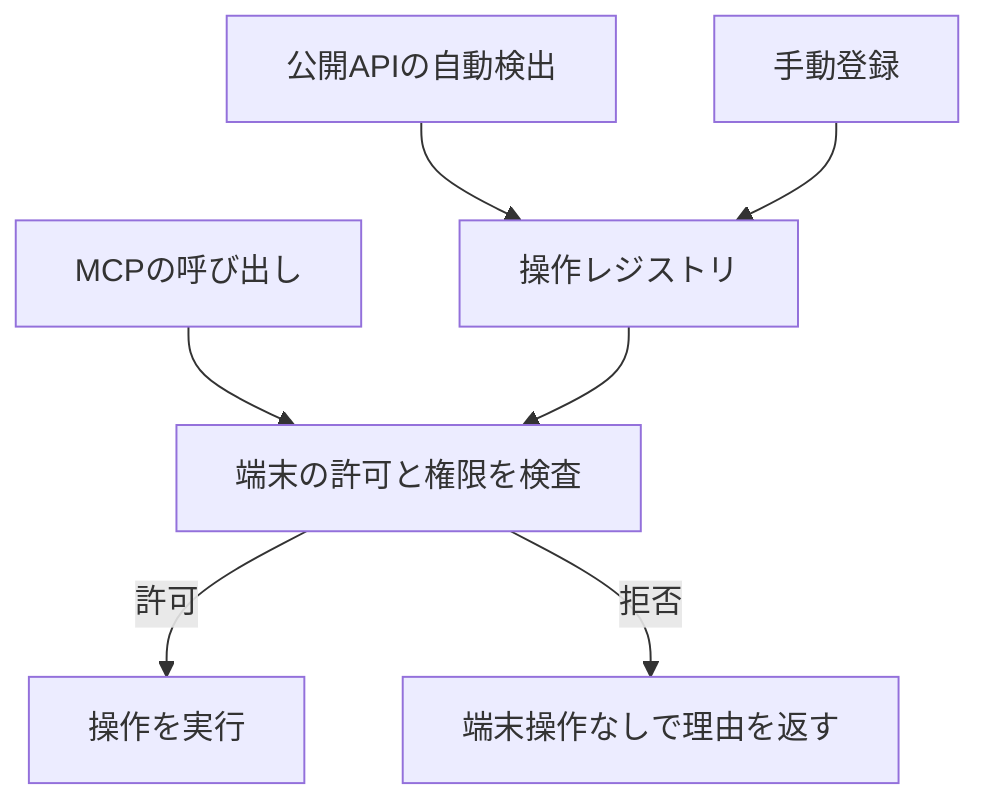

## 背景と設計

Androidの公開APIをMCPの操作として追加する方法を検討した。個別に手動登録するだけだと対象を増やすたびに作業が必要になる。自動検出だけでは個別の機能や例外の扱いが難しい。そこで自動検出と手動登録を併用する方式を選んだ。旧方式の実装有無は未確認。

自動検出で操作の候補を集め、例外や個別対応が必要な機能を手動登録で補う。候補に載る条件と、実行時の許可・端末権限のチェックは独立させる。公開APIとして見つけられても、操作に必要な権限は端末側で判定する。

候補を追加する入口が2つあっても、実行時は同じ検査を通す。例えば読み取り専用の操作だけを許可する端末では、新しく検出された書き込み操作も、同じ名前の手動登録も実行前に拒否する。レジストリの識別子が重複したときの扱いも定義しておくと、どの操作が実行されるかを登録順から切り離せる。ここでの例は設計時に確認できる条件。

自動検出と手動登録は候補を作る入口であり、実行許可を与える処理ではない。登録時に識別子の重複を拒否または明示的に上書きし、実行時には端末の権限、ユーザーの承認、対象データの範囲を毎回検査する。

自動検出の実装候補は、ビルド時に対象SDKの公開シグネチャや既知のIntentを絞り、型と説明付きの候補を生成する方式。端末ではOSレベル、端末機能、Intentを処理できるアプリの有無を確認する。シグネチャからはツールの用途、必要なユーザー操作、引数の安全な範囲や副作用を推定しきれないため、MCPの `tools/list` へ公開する項目はレビュー済みの登録に限る。Androidの非SDKインターフェースは検出対象から外す。

端末の書き込み操作は、許可確認後に対象の状態が変わる場合がある。更新時に前提を再検査し、競合なら読み直しを求める。通信断で実行結果が分からない操作は、再実行前に状態を照合する。

## 環境と確認状況

Android、MCP。Android OS・SDK・MCP実装の版は未確認。

方式選択を確認。具体的なAPI検出方法、権限の実装、端末上の動作は未確認。

- [MCPのTools](https://modelcontextprotocol.io/specification/2025-11-25/server/tools)
- [Androidの非SDKインターフェースの制限](https://developer.android.com/guide/app-compatibility/restrictions-non-sdk-interfaces)
