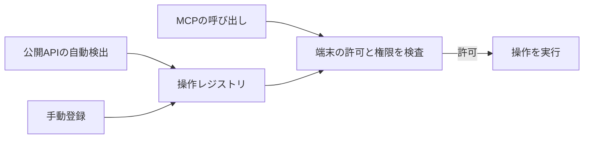

## 背景と設計

Androidの公開APIをMCPの操作として追加する方法を検討した。個別に手動登録するだけだと対象を増やすたびに作業が必要になる。自動検出だけでは個別の機能や例外の扱いが難しい。そこで自動検出と手動登録を併用する方式を選んだ。旧方式の実装有無は未確認。

自動検出で操作の候補を集め、例外や個別対応が必要な機能を手動登録で補う。候補に載る条件と、実行時の許可・端末権限のチェックは独立させる。公開APIとして見つけられても、操作に必要な権限は端末側で判定する。

候補を追加する入口が2つあっても、実行時は同じ検査を通す。例えば読み取り専用の操作だけを許可する端末では、新しく検出された書き込み操作も、同じ名前の手動登録も実行前に拒否する。レジストリの識別子が重複したときの扱いも定義しておくと、どの操作が実行されるかを登録順から切り離せる。ここでの例は設計時に確認できる条件。

## 概念図

## 環境と確認状況

Android、MCP。Android OS・SDK・MCP実装の版は未確認。

方式選択を確認。具体的なAPI検出方法、権限の実装、端末上の動作は未確認。
