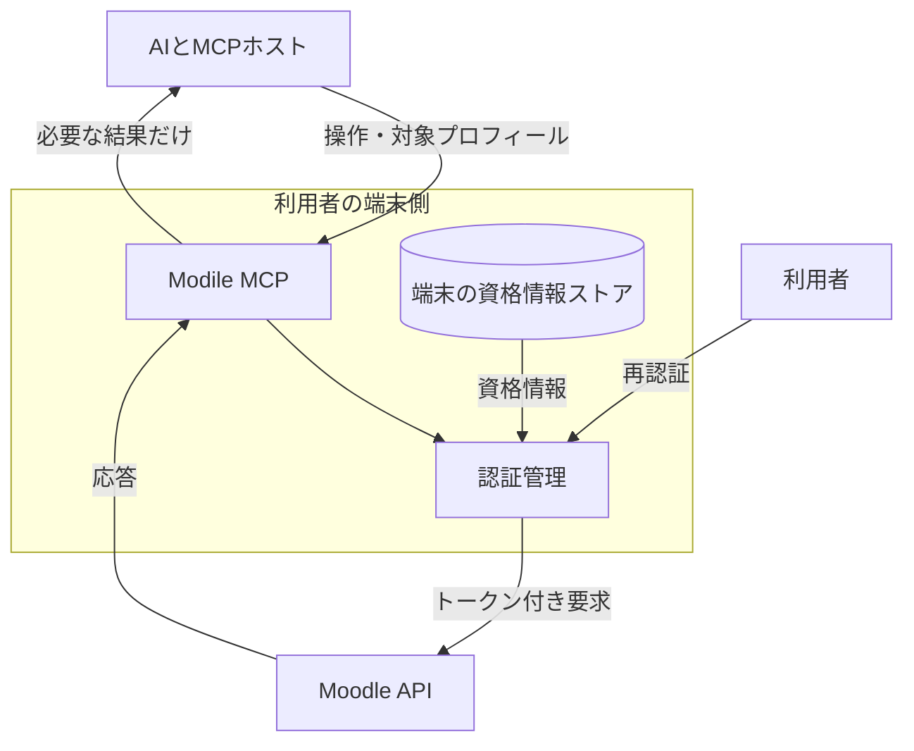

## 背景と設計

Moodleのトークンが失効しても、AIには操作の目的と対象だけを渡したい。トークンやパスワードをMCPの引数に含める案では、会話やツール呼び出しのログが認証情報の露出経路になる。旧実装の有無は未確認。

認証管理をMCPの操作インターフェースから分離する方針を採った。AIは許可された操作を要求し、端末側の認証管理がトークンを使ってMoodle APIを呼ぶ。KeychainやKeystoreへの保管と、失効時に利用者だけが操作する再認証画面は検討候補。

認証情報をツール引数から外した後も、操作ログやAPIエラーにトークンを出さない設計が要る。

例えば資格情報が期限切れなら、ツールは再認証が必要だと分かる状態だけを返し、利用者が端末の認証画面で続きの操作をする。APIのレスポンスをそのままツール結果へ渡すと、上流が返した詳細が会話やログに残りうる。返す情報は操作結果に必要な項目に絞る。資格情報を隠した後も、サーバー側で呼び出し元と対象プロフィールの組を認可する必要がある。

図の境界はAIと端末側の認証管理の間。MCP引数には資格情報を置かず、端末側だけがトークンを参照する。再認証が必要な場合、認証画面の完了を待って同じ操作を安全に再試行できるよう、操作IDと冪等性の扱いを別途定義する。

## 環境と確認状況

Moodle、Modile MCP。対象OS、Moodle APIとMCP実装の版は未確認。

認証情報を隔離する方針を確認。現在のModileの `connector.rs` では `list_profiles` がプロフィール名と既定値を返し、セッション確認ツールがホスト保有の資格情報でセッション復旧を試みる。資格情報ストアの実装もソースにある。ここで描いた再認証UIの接続、OS別の保管動作、結果不明時の再試行は未確認。
