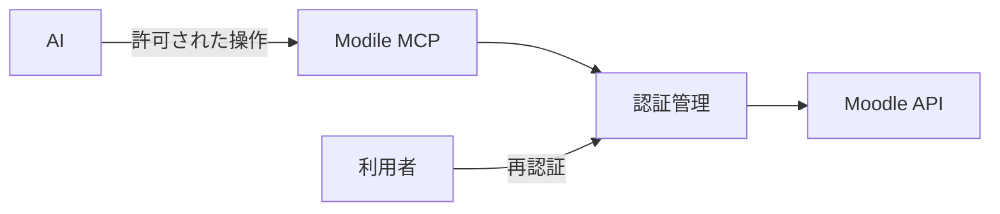

## 背景と設計

Moodleのトークンが失効しても、AIには操作の目的と対象だけを渡したい。トークンやパスワードをMCPの引数に含める案では、会話やツール呼び出しのログが認証情報の露出経路になる。旧実装の有無は未確認。

認証管理をMCPの操作インターフェースから分離する方針を採った。AIは許可された操作を要求し、端末側の認証管理がトークンを使ってMoodle APIを呼ぶ。KeychainやKeystoreへの保管と、失効時に利用者だけが操作する再認証画面は検討候補。

認証情報をツール引数から外した後も、操作ログやAPIエラーにトークンを出さない設計が要る。

例えば資格情報が期限切れなら、ツールは再認証が必要だと分かる状態だけを返し、利用者が端末の認証画面で続きの操作をする。APIのレスポンスをそのままツール結果へ渡すと、上流が返した詳細が会話やログに残りうる。返す情報は操作結果に必要な項目に絞る。資格情報を隠した後も、サーバー側で呼び出し元と対象プロフィールの組を認可する必要がある。

## 概念図

## 環境と確認状況

Moodle、Modile MCP。対象OS、Moodle APIとMCP実装の版は未確認。

認証情報を隔離する方針を確認。端末での保管・再認証の実装と動作は未確認。
