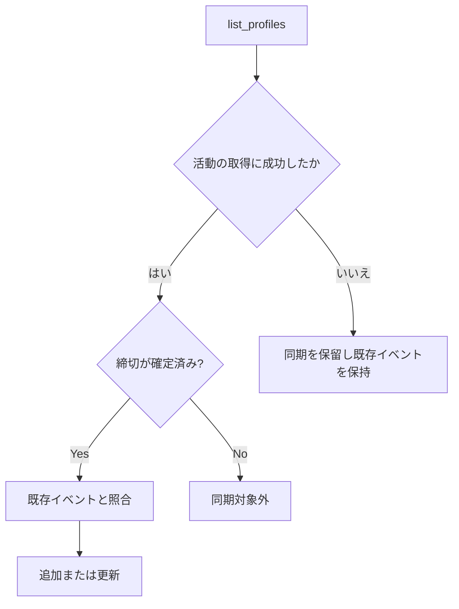

## 背景と設計

複数のMoodleアカウントの課題を一つのカレンダーに載せると、課題IDだけでは別プロフィールのイベントを区別できない場合がある。そこで `list_profiles` でプロフィールを列挙し、コース・活動・提出状態をプロフィール単位で取得する仕様を決めた。

同期対象は確定した締切。プロフィール識別子と課題IDの組で既存イベントを照合し、初回は追加、締切変更時は更新する。時刻はAsia/Tokyoとして反映する。学内限定の接続などで取得できない場合は、取得失敗と締切の変更を区別し、古い情報を最新として扱わない。

## 変更される締切をイベントIDから外す

タイトルや締切は編集されるので、照合キーにはプロフィールの安定した識別子と課題IDを使う。例えばGoogle Calendarの専用カレンダーに同期するなら、イベントの非公開の拡張プロパティに外部キーを記録して検索できる。検索してから追加するだけでは並行実行時の重複を防げない。並行して走る運用なら、同じカレンダーへの同期を直列化するか、作成時に同じイベントIDを使って競合を処理する。

取得失敗は「締切が取り消された」という情報を含まない。対象プロフィールの取得が失敗した回は、そのプロフィールのイベントを削除する根拠には使わない。時刻は取得元の時刻が表す瞬間を保ったまま、`Asia/Tokyo` で表示する。

同期が並行すると、重複作成だけでなく古い締切で新しい更新を上書きすることもある。同期をカレンダー単位で直列化するか、更新時に既存イベントのETagを `If-Match` で渡し、競合時は情報を取り直す。取得成功後に締切が消えた場合の削除は、別の同期規則として扱う。

## 環境と確認状況

Moodle、Modile MCP、Google Calendar、Asia/Tokyo。Moodle・各APIの版は未確認。

重複防止と締切更新は決定済みの仕様。プロフィールごとの取得、照合、再同期の成功は未確認。

- [Google Calendar APIの拡張プロパティ](https://developers.google.com/workspace/calendar/api/guides/extended-properties)

- [Google Calendar APIのバージョン付きリソース](https://developers.google.com/workspace/calendar/api/guides/version-resources)
