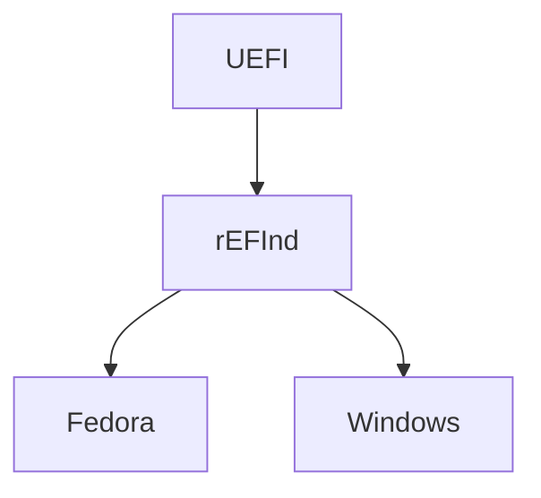

## 背景と設計

1台のPCでFedoraとWindowsを選ぶため、UEFIからrEFIndを起動し、同じメニューでOSを選ぶ構成を検討した。旧画面で具体的な不具合があったかは未確認。起動画面にはrEFInd Minimal Darkを採用する方針を決めた。

テーマが決めるのはメニューの見た目。UEFIがrEFIndを起動できること、rEFIndがそれぞれの起動先を選べること、その先で両OSが起動することは別々に確認する。導入時は起動順や既存エントリを控え、テーマを適用する前後で各OSの起動を確かめると、失敗した段階を絞れる。

## 概念図

## 環境と確認状況

Fedora、Windows、UEFI、rEFInd Minimal Dark。各OSとrEFIndの版は未確認。

テーマ選択と導入方針を確認。インストール・起動順の反映・両OSの起動は未確認。
