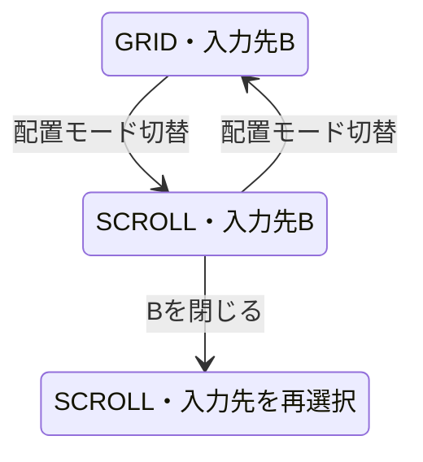

## 背景と設計

GRID・BSP・SCROLLで別々のウィンドウ順を持つと、モード切替で操作対象を見失いやすい。そこでShared Orderを共通の基準に置き、各モードが順序を解釈して配置する。Fit to Screenも設計の基準に含めた。

入力では、フォーカス・カーソル位置・重なり順を独立させる。Keep Focus、Static Cursor、Click to Focusを選び、ポインターを載せただけではフォーカスを移さない。FloatingのFocus Onlyでは、フォーカスの移動で自動的に前面に出さない。Always-on-Topのピン留めには別の規則を設ける。

## モード切替を状態の差分で考える

例えば共通順序が `[A, B, C]` で、入力先がBだとする。GRIDからSCROLLへ切り替えると各ウィンドウの画面上の矩形は変わるが、入力先はBのままにできる。フォーカスを配列の位置や矩形から求める代わりに、ウィンドウのIDで保持する設計例。Bが閉じられた場合は入力先を別途選び直す必要がある。

重なり順を独立させると、背面にフォーカスを移す操作が可能になる。手前のウィンドウで隠れている場合は入力先を見失いやすいため、フォーカス表示や明示的に前面へ出す操作も考慮する。

## 環境と確認状況

Linux向けShojiWM設計仕様 v0.1。対象コンポジター・実装言語・版は未確認。

配置とフォーカスの基本規則は確定した設計。実装と挙動は未確認。一部の詳細は検討中。
