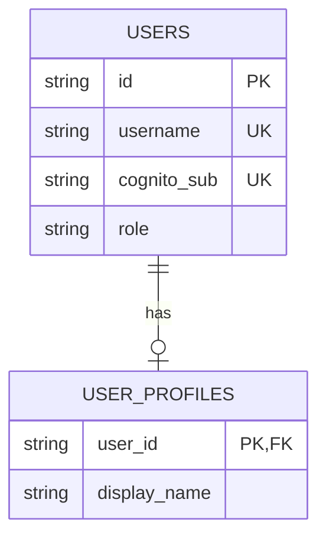

## 背景と設計

認証識別子、部員資格、公開プロフィールを同じ扱いにすると、公開画面向けの取得処理に認証用の情報が混ざりやすい。旧テーブルが実装されていたかは未確認。

当時の案は `users` と `user_profiles` を分け、`user_id` で結ぶ構成。ユーザー名とCognitoの `sub` に一意制約を置き、プロフィールの外部キーには `ON DELETE CASCADE` を想定した。登録直後は現部員の権限を付けず、所属や権限は必要に応じて変更する。

プロフィールを別表にしても、公開フィールドは取得処理で明示する必要がある。認証基盤を変更する場合は外部IDの列と一意性の条件を見直す。

## 一対一の制約と公開範囲

`user_profiles.user_id` を主キーかつ外部キーにすると、ユーザーがいないプロフィールと、同じユーザーの2件目を拒める。以下はER図に対応するSQLiteの設計例。`ON DELETE CASCADE` は、親の削除にプロフィールの削除を連動させたい場合に使う。

```sql
PRAGMA foreign_keys = ON;
CREATE TABLE users (
    id TEXT PRIMARY KEY NOT NULL,
    username TEXT NOT NULL UNIQUE,
    cognito_sub TEXT NOT NULL UNIQUE,
    role TEXT NOT NULL DEFAULT 'pending'
);
CREATE TABLE user_profiles (
    user_id TEXT PRIMARY KEY NOT NULL REFERENCES users(id) ON DELETE CASCADE,
    display_name TEXT NOT NULL
);
```

公開APIは `display_name` などの公開列を明示して返す。所属が認可にも使われるなら、自己編集できるプロフィール更新と、管理者が所属を更新する経路も分ける。認証基盤が複数になる場合は、外部の `(iss, sub)` とアプリ内のユーザーIDの対応を独立させる方法がある。同じメールアドレスだけでアカウントを自動的に結び付ける設計には、メールの検証と連携ルールが別途必要になる。



`USERS ||--o| USER_PROFILES` は、ユーザー1件に対してプロフィールが0件または1件という意味。主キーが2件目を拒み、外部キーがユーザーの存在を要求する。ユーザーにプロフィールを必ず用意する要件や、権限更新を管理者だけに許可する要件は、アプリケーションで扱う。認証情報や所属の公開可否はER図の記号だけでは決まらず、SQLの投影と認可処理で制御する。

## 環境と確認状況

Cloudflare D1、React Router、当時のCognito。SDK・SQLite実行版は未確認。

分離と初期権限は当時の設計方針。本番D1への適用と公開APIの挙動は未確認。

掲載したSQLをSQLite 3.54.1のインメモリDBで検証した。プロフィール未作成の行は許可され、親のないプロフィールや同じユーザーの2件目は拒否された。ユーザー名とCognitoの `sub` の重複拒否、親削除時の連動削除も確認した。

- [SQLiteの外部キー制約](https://www.sqlite.org/foreignkeys.html)
- [OpenID Connect CoreのSubject Identifier](https://openid.net/specs/openid-connect-core-1_0.html#SubjectIDTypes)
