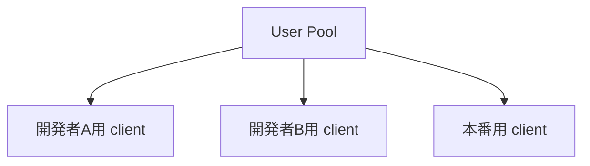

## 背景と設計

開発者全員でApp clientを共有すると、ローカルのコールバックURLの追加や設定変更が他の担当者にも影響しうる。Cognitoを採用していた時点では、開発者ごとに1つ、本番に共通1つのApp clientを用意する方針を決めた。

分ける単位は同じUser Pool内のクライアント設定。コールバックURLなどを個別に変更できるが、ユーザーの保管先は同じ。ユーザーデータまで隔離したい場合はUser Pool自体の分離を検討する。Client IDはクライアントの識別子として扱い、Client Secretを使う構成では秘密管理に置く。

## 何を隔離したいかで分割単位を決める

| 分割単位 | 分かれるもの | 共有されるもの |
| --- | --- | --- |
| App client | クライアントID、許可したコールバックURLなど | ユーザーとUser Poolの設定 |
| User Pool | ユーザーの保管先とプール設定 | アプリで別途連携したものだけ |

App clientを分けると、開発者の追加や離脱に合わせて設定を増減できる。その分、OAuthフローやスコープに差が出ないよう共通設定も管理する必要がある。API側でトークンを受け取る場合は、受け入れるクライアントを明示し、本番で開発用クライアントのトークンを受理できるかも確認する。

3つのApp clientは同じUser Pool内の別クライアント。図の分岐はユーザーの複製ではなく、認可要求で使う `client_id` と許可設定の分離を示す。APIがトークンを検証する場合、発行元と受け入れるApp clientを明示する。

CognitoのIDトークンは `aud`、アクセストークンは `client_id` でApp clientを識別する。受け取る用途に合わせて `token_use` を確認し、署名と期限を検証する。アクセストークンの `aud` が存在する構成では、対象リソースの検証にも用いる。

## 環境と確認状況

Amazon Cognito User Pools、React Router、Cloudflare Workers。SDK・実際の設定値は未確認。

Cognito採用時の決定を確認。設定の反映と現行利用は未確認。

- [CognitoのUser Pool App client](https://docs.aws.amazon.com/cognito/latest/developerguide/user-pool-settings-client-apps.html)

- [CognitoのJWT検証](https://docs.aws.amazon.com/cognito/latest/developerguide/amazon-cognito-user-pools-using-tokens-verifying-a-jwt.html)
