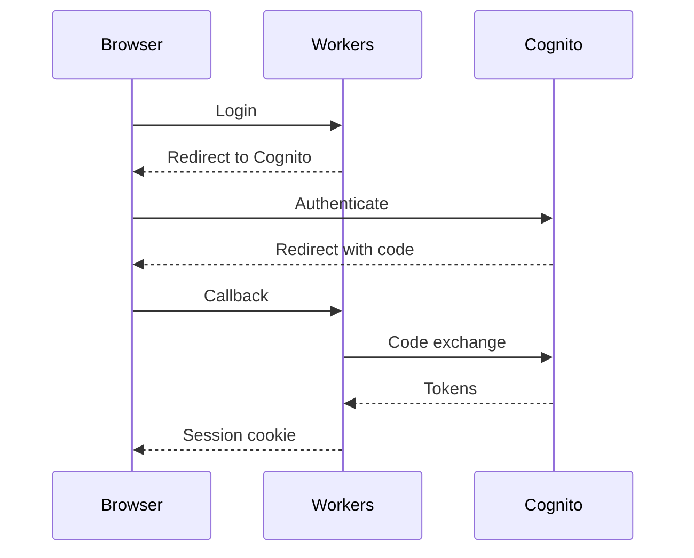

## 背景と設計

2026年11月8日にCognitoを採用し、当初は独自フォームからReact Routerのactionを経由してUser Pools APIを呼ぶ案だった。フォームを運用する負担を減らしたいという希望から、専用認証サブドメインでホスト型ログインを使う案へ移った。

独自フォームの `InitiateAuth` と、OAuth/OIDCの認可コードフローではアプリが受け取る入力が異なる。後者ではPKCE、`state`、`nonce`、コールバックとトークンの検証を設計する。図は検討したホスト型フローの概念図。

11月23日以降はユーザー名とパスワードの廃止を希望し、Discordなどの外部認証、パスキー、Supabase Authを検討した。認証はIdPに委任し、アプリ内の所属・認可はD1で管理する役割分担が各案に共通する。

## 概念図

## コールバックで照合するもの

`state` はログイン開始時のブラウザの状態と応答を結び付ける。PKCEでは認可要求に検証値のハッシュを送り、コード交換時に元の検証値を提示する。OIDCで `nonce` を送った場合は、返ったIDトークンの `nonce` と照合する。これらに加え、IDトークンの署名、発行者、有効期限、対象クライアントを検証する。

IdPで本人と確認できた後に、アプリ内のユーザーを解決し、アプリ自身のセッションを発行する。例えばログインできることと、部員向けの操作を許可することは別々に判定する。[ユーザーと公開プロフィールの設計](/posts/web/account-and-public-profile)では、公開範囲と認可をどう分けるかを扱う。

## 環境と確認状況

React Router、Cloudflare Workers・D1、Amazon Cognito。Supabase Authは検討段階。SDK・ランタイムの版は未確認。

Cognitoは当時の採用判断。ホスト型への移行、Supabase Authの採否と実装は未確認。

## 参照元

- [Cognitoの認可エンドポイント](https://docs.aws.amazon.com/cognito/latest/developerguide/authorization-endpoint.html)

- [PKCEの仕様](https://datatracker.ietf.org/doc/html/rfc7636)
- [OpenID Connect CoreのIDトークン検証](https://openid.net/specs/openid-connect-core-1_0.html#IDTokenValidation)
