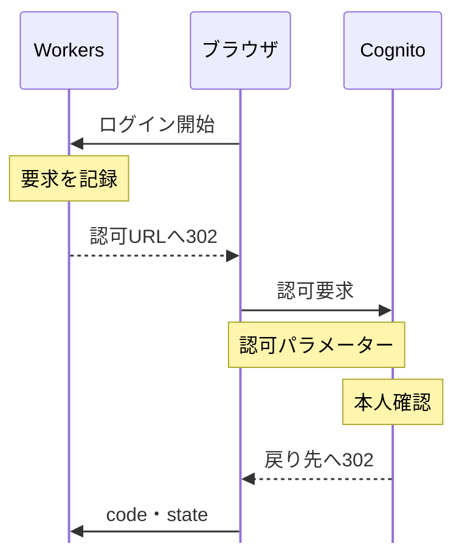
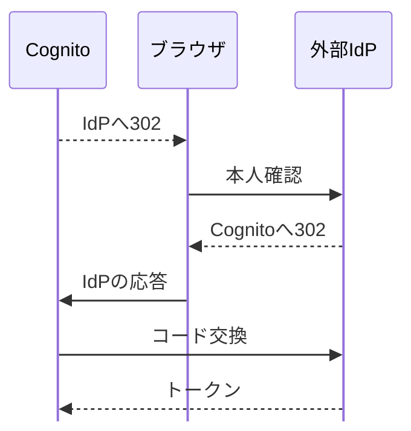
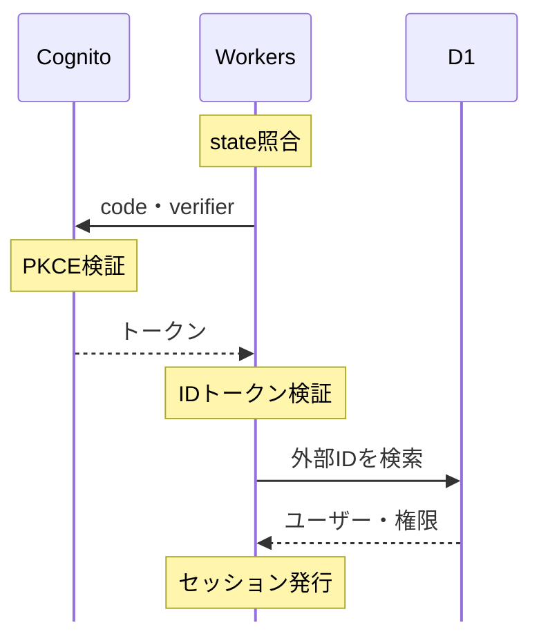

## 背景と設計

2026年11月8日にCognitoを採用し、当初は独自フォームからReact Routerのactionを経由してUser Pools APIを呼ぶ案だった。フォームを運用する負担を減らしたいという希望から、専用認証サブドメインでホスト型ログインを使う案へ移った。

独自フォームの `InitiateAuth` と、OAuth/OIDCの認可コードフローではアプリが受け取る入力が異なる。後者ではPKCE、`state`、`nonce`、コールバックとトークンの検証を設計する。Workersはログイン開始時に `state`、`nonce`、`code_verifier` を短期保存し、送信する認可要求に `state`、`nonce`、`code_challenge` を含める。

11月23日以降はユーザー名とパスワードの廃止を希望し、Discordなどの外部認証、パスキー、Supabase Authを検討した。認証はIdPに委任し、アプリ内の所属・認可はD1で管理する役割分担が各案に共通する。

### 認可要求とコールバック

外部IdPと連携する場合、本人確認の途中でCognitoはブラウザを外部IdPへ転送する。利用者は外部IdPでログインし、ブラウザを介してCognitoへ戻る。上流がOIDCの場合、Cognitoは上流のコード交換とトークン検証を済ませてから、Workers向けの認可コードを発行する。上流で発行されたコードとWorkersが受け取るコードは、宛先と発行元が異なる。

外部IdPを使う場合だけ、Cognitoでの本人確認が次の経路を通る。

### コード交換とアプリのセッション

Workersは処理に成功した場合だけ、ブラウザにアプリのセッションCookieを返す。外部IDの照合には、検証済みの発行者とユーザー識別子 `(iss, sub)` を使う。

## コールバックで照合するもの

`state` はログイン開始時のブラウザの状態と応答を結び付け、CSRFを防ぐ。PKCEでは認可要求に `code_challenge` を送り、コード交換時に元の `code_verifier` を提示する。アプリは `S256` で作ったチャレンジを使い、検証に失敗したらセッションを発行しない。OIDCで `nonce` を送った場合は、返ったIDトークンの `nonce` と照合する。これらに加え、IDトークンの署名、発行者（`iss`）、有効期限（`exp`）、対象クライアント（`aud`）を検証する。

IdPで本人と確認できた後に、アプリ内のユーザーを解決し、アプリ自身のセッションを発行する。例えばログインできることと、部員向けの操作を許可することは別々に判定する。[ユーザーと公開プロフィールの設計](/posts/web/account-and-public-profile)では、公開範囲と認可をどう分けるかを扱う。

IDトークンはアプリに対する認証結果、アクセストークンは許可されたAPIを呼ぶ資格情報。必要なトークンだけをWorkers側で管理し、ブラウザには `HttpOnly`・`Secure` を付けたセッションIDのCookieを返す設計例とする。Cookieの `SameSite` はコールバック時に必要な状態を照合できるよう設定する。ホスト型画面ではログイン資格情報はCognitoまたは上流IdPが受け取り、D1には照合用の外部IDや所属を保存する。

## 環境と確認状況

React Router、Cloudflare Workers・D1、Amazon Cognito。Supabase Authは検討段階。SDK・ランタイムの版は未確認。

現在確認したアプリのソースには、独自フォームから `InitiateAuth` を呼び、取得した `sub` をD1で照合してセッションを作る実装がある。上の図は検討したホスト型の方式。公開環境で稼働する版と、ホスト型・Supabase Authへの移行状況は未確認。

## 参照元

- [Cognitoの認可エンドポイント](https://docs.aws.amazon.com/cognito/latest/developerguide/authorization-endpoint.html)

- [PKCEの仕様](https://datatracker.ietf.org/doc/html/rfc7636)
- [OpenID Connect CoreのIDトークン検証](https://openid.net/specs/openid-connect-core-1_0.html#IDTokenValidation)
