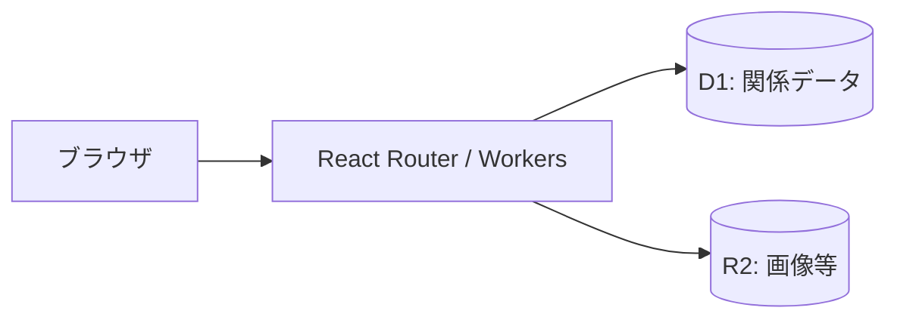

## 背景と設計

サークルWebにはReact Routerで書かれた画面があった。Cloudflareを使う方針を決める際に、Next.jsへの移行も論点になった。移行を選ぶと、既存の画面やルートの移し替えと見直しが増える。そこで現行のReact Routerを維持し、既存資産を使う方針を採った。

保存先はデータの性質で分けた。ユーザーや所属など、関係を照会するデータはD1へ。画像などのオブジェクトはR2へ置く。画像と関係データをひも付ける場合は、どの側がオブジェクトのキーを管理するかを先に決めると扱いやすい。

## DBの行と画像の更新が片方だけ成功する場合

画像のキーをD1に持たせる構成では、R2へのアップロードとD1の更新が別処理になる。例えばアップロードの後でD1の更新が失敗すると、どの行からも参照されない画像が残る。設計例として、再試行時に同じ画像キーを使えるようにし、処理が完了しなかった画像を後で照合して掃除する方法がある。逆に行を先に公開すると、アップロード完了まで画像が欠けた表示になる。どちらを先に行うかは、読者に見せてよい途中状態から決める。

D1とR2は別サービスのため、同一リクエストで両方が原子的に更新されるとは限らない。公開前に画像の存在を確認し、再試行を同じオブジェクトキーへ向けるなど、途中状態と後始末を設計に含める。

## 環境と確認状況

React Router、Cloudflare Workers・D1・R2。Node.jsとSDKの版は未確認。

フロントエンド維持と保存先の分担は当時の設計方針。Rust APIの担当範囲と全機能の実装は未確認。

- [Cloudflare D1](https://developers.cloudflare.com/d1/)
- [Cloudflare R2](https://developers.cloudflare.com/r2/)
