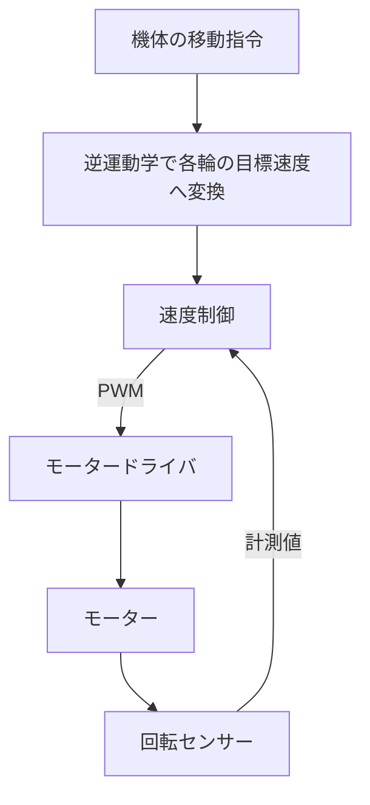

この記事を書くことを決めた理由としては、

1. 何も知らない状態から始めるので知識の差が少ない
2. 現体制では知識の共有があまりできていない

というのが大きくある。

とりあえず、何も知らない状態なので書き殴り状態にはなるが、いつか誰かの役に立つと嬉しい。
無知の状態なのでAI由来の知識が多くなることは確実ということは認識しておいて欲しい。

なんなら、自分も何から学べばいいのかわからないのでAIに提案してもらっている。許して。

## ロボットを動かすまでの信号経路

たとえば4輪オムニでは、機体をどちらへ動かすかを[逆運動学](/posts/robotics/four-wheel-omni-kinematics)で各輪の目標回転速度へ変換する。次に、モーターの回転速度を測れる構成なら、目標との差を使ってドライバへの指令を調整する。マイコンが指令をPWMで送る場合は、[タイマーとGPIOの関係](/posts/robotics/stm32-pwm-timer-gpio)を追うと、数値がどのようにピンの波形に変わるか分かる。

回転センサーを使って各車輪の速度を調整する場合の概念図。

