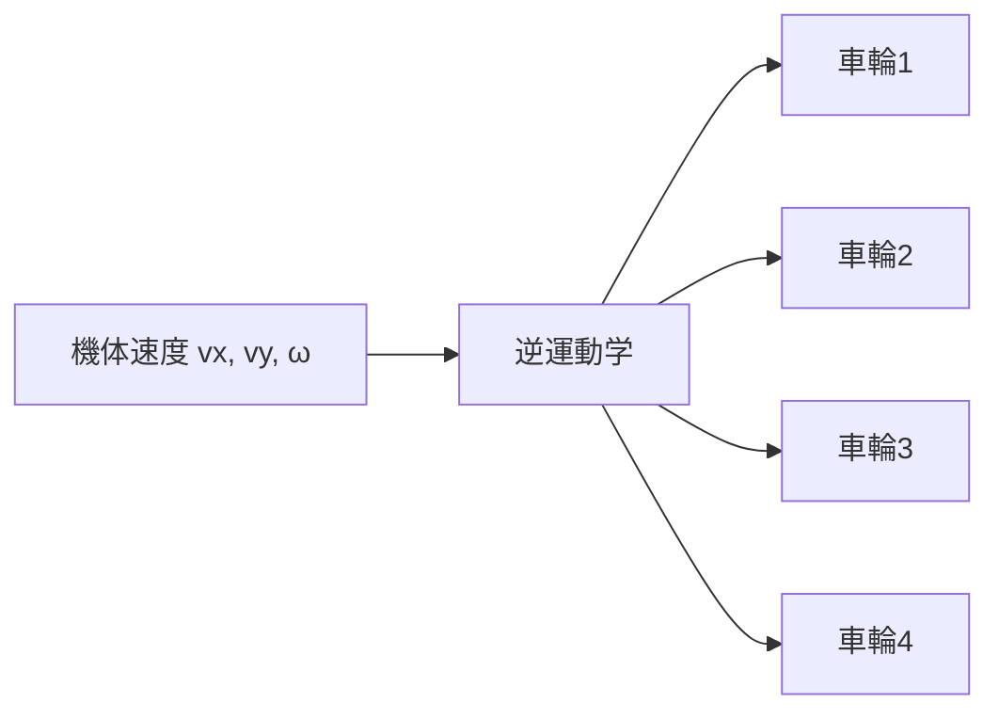

## 背景と仕組み

機体を斜めに移動しながら回すには、並進速度と角速度を各車輪の回転速度へ変換する。前進・横移動・旋回を固定パターンとして持つ代わりに、車輪の位置と駆動方向を使って合成する手順を学んだ。

機体座標で車輪の位置を (xᵢ, yᵢ)、正回転時の駆動方向を単位ベクトル (dₓ, dᵧ) とする。反時計回りを正とすると車輪位置の速度は (vₓ − ωyᵢ, vᵧ + ωxᵢ)。これを駆動方向に内積で投影し、車輪半径で割ると車輪の目標角速度になる。実装時は各車輪の正回転方向を先に決め、前進・横移動・旋回を個別に指令して符号を確認する。

## 単位と符号を一輪で確認する

車輪の位置を (0.20, 0.15) m、駆動方向を機体のx軸正方向、半径を0.05 mと仮定する。前進を0.30 m/s、反時計回りの旋回を1 rad/sとすると、駆動方向の速度は `0.30 − 1 × 0.15 = 0.15 m/s`。半径で割ると `3 rad/s` になる。この車輪はy軸の正側にあるため、反時計回りの旋回でx方向の前進成分が減る。実機の寸法を使わない計算例。

各輪を個別に上限で切ると、並進と旋回の比率が変わる。車輪の上限が同じ場合、最大絶対値が上限を超えたら全輪の指令を同じ比率で縮める方法がある。床との滑りやモーターの応答は、この逆運動学の式とは別に扱う。

## 概念図

## 環境と確認状況

STM32F446RE、4輪オムニ。車輪半径・取り付け位置・ファームウェアの版は未確認。

逆運動学の理解を記録。実機の係数、符号、走行は未確認。

- [Modern Robotics 13.2のオムニホイールの運動学](https://modernrobotics.northwestern.edu/nu-gm-book-resource/13-2-omnidirectional-wheeled-mobile-robots-part-1-of-2/)
