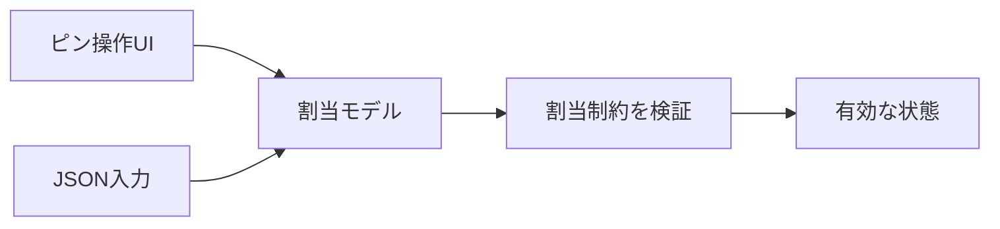

## 背景と設計

ピンの割当を画面だけで検査すると、JSONの読み込みなど別の経路で検査が抜ける。そこで初版は画面と割当モデルを分け、画面操作とJSON入力の両方から同じ制約を適用する設計を採った。実際の旧実装に検査漏れがあったかは未確認。

モデルは使用不可ピン、二重割当、ピンが対応しない機能を検査する。React側は機能表示や色変更を担当し、自動保存とJSON入出力を提供する。この分離により、制約のテストを画面操作から独立して行える。ボード上のジャンパや周辺機能同士の詳細な競合、CubeMXの `.ioc` 連携は別に確認が要る。

## JSONの形式と割当の制約を順に検査する

最初に `JSON.parse` と型の検査で、ピン名と機能名を持つ入力として読めるかを確かめる。その後、同じピンを2回指定していないかなど、割当全体の制約を調べる。例えば `PA8` が2件現れるJSONは、各項目の形式が正しくても割当としては無効。設計例として、読み込んだ候補を別の状態に組み立て、全件を検査できた時点で現在の状態と入れ替えると、途中の項目だけが反映されるのを防げる。

## 概念図

## 環境と確認状況

NUCLEO-F446RE、React、JSON。React・Node.js・テストツールの版は未確認。

初版仕様の承認と実装の報告あり。型検査・本番ビルド、モデル10件・ブラウザ5件の通過は当時の報告。実機は未確認。

- [STMicroelectronicsのSTM32F446資料一覧](https://www.st.com/en/microcontrollers-microprocessors/stm32f446/documentation.html)
