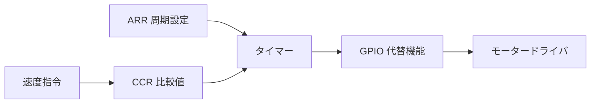

## 背景と仕組み

モーターの速度指令を受け取ったら、タイマーの比較値に変換し、対応するGPIOからPWMを出す。GPIOの代替機能は、タイマーチャネルの出力をピンへつなぐ役割を持つ。

アップカウント、エッジアライン、PWM mode 1、アクティブHighを例にする。タイマーは 0 から ARR まで数え、CNT が CCR 未満の間に出力が有効になる。例えば ARR = 999、CCR = 250 なら、1000カウント中250カウントが有効となり、デューティ比は25%。周期はタイマークロックとプリスケーラにも依存する。

実機では対象チャネルとピンの代替機能を確認し、出力の周期とデューティ比を測る。指令に対する回転数は、ドライバや負荷の影響も受ける。

周波数の計算には、タイマー入力クロック `f_TIM` とプリスケーラ `PSC` を使う。この例のモードでは `f_PWM = f_TIM / ((PSC + 1) × (ARR + 1))`。たとえば入力が仮に80 MHz、PSCが79、ARRが999なら1 kHzになる。実機の `f_TIM` はクロックツリーで確認する。CPUクロックと同じ値を入れるとは限らない。

CNTとCCRの比較で波形が決まり、チャネルの出力許可とGPIOの代替機能でピンまで届く。波形が出ないときは、カウンタの動作、出力許可、ピン割当の順に切り分けられる。TIM1などではメイン出力許可も確認する。

## 概念図

## 環境と確認状況

STM32F446RE、C。HAL・コンパイラの版とタイマークロックは未確認。

活動報告で信号経路の理解を確認。実機出力と回転数の測定は未確認。

## 参照元

- [STMicroelectronicsのSTM32F446製品ドキュメント](https://www.st.com/en/microcontrollers-microprocessors/stm32f446/documentation.html)
