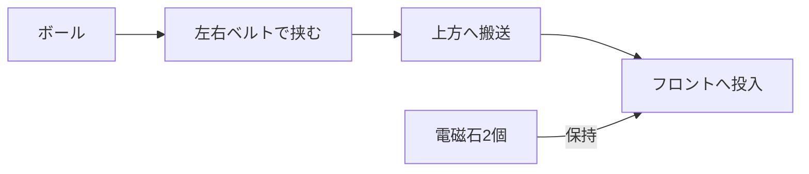

## 背景と設計

フロントを保持しながら、球を繰り返し受け取って投入する機構を検討した。吸い込みや2D・3Dアームも候補に挙がったが、個別の不採用理由は未確認。指定された案は4輪独立ステアの走行部、前方の昇降機構、フロントの上部に電磁石2個、球を挟む左右のベルトで構成する。

ベルトで球を上方へ運び、電磁石が保持しているフロントへ直接渡す。保持と搬送を担当する機構が分かれるので、試作では受け渡し位置、球の詰まり、フロント保持力、昇降時の転倒余裕を個別に確かめる。

## 概念図

## 環境と確認状況

春ロボコンの機体案。4輪独立ステア、前方昇降、電磁石2個、左右ベルト。機器型番・CAD・ファームウェアの版は未確認。

機体案として構成を指定。寸法、保持力、搬送性能、実機と大会ルールへの適合は未確認。
